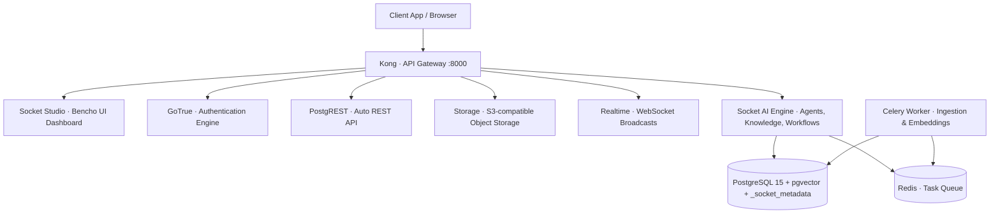

<p align="center">
  <picture>
    <source media="(prefers-color-scheme: dark)" srcset="frontend/apps/studio/public/img/socket-light-logo.svg" />
    <source media="(prefers-color-scheme: light)" srcset="frontend/apps/studio/public/img/socket-dark-logo.svg" />
    
  </picture>
</p>

<h1 align="center">Socket</h1>

<p align="center">
  <strong>Next-Generation Open-Source Backend-as-a-Service (BaaS) with Native Multi-Tenancy, Autonomous AI Agents, RAG Knowledge Bases & Bencho Design System</strong>
</p>

<p align="center">
  <a href="#features">Features</a> •
  <a href="#architecture">Architecture</a> •
  <a href="#quickstart">Quickstart</a> •
  <a href="#multi-tenancy">Multi-Tenancy</a> •
  <a href="#design-system">Design System</a> •
  <a href="#security">Security</a>
</p>

---

## Overview

**Socket** is an open-source, production-ready Backend-as-a-Service (BaaS) that fuses the battle-tested PostgreSQL data plane of Supabase with high-performance multi-tenancy, autonomous AI agent orchestration, multi-modal knowledge ingestion, and a state-of-the-art UI inspired by **bencho.dev**.

While traditional self-hosted solutions restrict you to a single hardcoded project and basic dashboard, **Socket provides full multi-tenancy out of the box**—allowing you to create, isolate, and switch between multiple Organizations and Projects dynamically, directly from the studio interface.

---

## Features

- 🏢 **True Multi-Tenancy**: Manage multiple Organizations and Projects from a unified breadcrumb switcher, backed by persistent PostgreSQL metadata (`_socket_metadata`).
- 🎨 **Bencho Design System**: Ultra-clean monochrome aesthetic with high-contrast dark accent buttons, pill-shaped geometry (`rounded-full`), and flat 24–28px card elevation.
- 🤖 **Autonomous AI Agents**: Deploy intelligent multi-step agents equipped with custom tools, system prompts, LLM integrations (OpenAI, Anthropic, Gemini, OpenRouter), and execution traces.
- 📚 **RAG Knowledge Bases**: Automated document extraction and indexing with hybrid dense + sparse vectors, powered by `pgvector`, PaddleOCR, and LlamaParse.
- ⚡ **Supabase Compatibility**: 100% compatible with Supabase client libraries (`@supabase/supabase-js`, Python, Flutter, Swift, Go, Kotlin).
- 🔐 **Enterprise Auth & Security**: GoTrue authentication with JWT, MFA, Third-Party Providers, Row-Level Security (RLS), and Kong API Gateway.
- 📦 **One-Command Deployment**: Run locally or in production via Docker Compose or Dokploy with zero hassle.

---

## Architecture

Everything in Socket is fronted by the high-performance **Kong API Gateway** on port `8000`:



### The 12 Stack Services

| Service | Role | Description |
|---|---|---|
| `studio` | **Socket Studio** | Modern Next.js dashboard featuring Bencho design & multi-tenancy switchers |
| `project-api` | **AI Backend** | REST API for agents, knowledge bases, vector search & orchestrations |
| `project-worker` | **Worker** | Background extraction, chunking, and embedding generation |
| `redis` | **Cache & Broker** | High-throughput broker for Celery tasks |
| `kong` | **Gateway** | Central API gateway routing traffic to all services |
| `auth` | **GoTrue** | User management, passwordless login, social OAuth & JWT issuance |
| `rest` | **PostgREST** | High-speed RESTful interface directly mapping to PostgreSQL tables |
| `storage` | **Storage API** | Bucket-based file storage with presigned URLs |
| `imgproxy` | **Image Proxy** | Dynamic image resizing and WebP conversion |
| `meta` | **Postgres Meta** | Database schema introspection and table editor backplane |
| `realtime` | **Realtime** | Change-data-capture broadcasts via WebSockets |
| `db` | **Postgres 15** | Relational database with `pgvector` and `_socket_metadata` |

---

## Quickstart

### 🚀 Option A: 1-Line Auto-Installer (Recommended)
Run this single command on any VPS or local Linux/macOS machine to install, configure, and launch Socket in under 30 seconds:

```bash
curl -fsSL https://raw.githubusercontent.com/saaduddinsony/socket/main/install.sh | bash
```

The installer verifies Docker, generates all cryptographic JWT keys, configures the environment, and starts the complete 12-service stack.

---

### 🛠️ Option B: Manual Setup

1. **Clone & Setup**
```bash
git clone https://github.com/saaduddinsony/socket.git
cd socket
cp .env.example .env
python3 gen-keys.py   # Or keys will be auto-generated by ./install.sh
```

2. **Configure LLM Keys (Optional)**
Open `.env` and supply your OpenAI or Gemini key for embeddings:
```env
OPENAI_API_KEY=sk-...
```

3. **Start Socket**
```bash
docker compose pull
docker compose up -d
```

Access the **Socket Studio Dashboard** at:
👉 **`http://localhost:8000`**

Log in using the `DASHBOARD_USERNAME` and `DASHBOARD_PASSWORD` in your `.env`.

---

### 📦 Option C: Deploy with Dokploy & Coolify
- **Dokploy**: Import [templates/dokploy.json](templates/dokploy.json) into your Dokploy Compose applications.
- **Coolify**: Deploy using the [templates/coolify.yaml](templates/coolify.yaml) template.

---

## Multi-Tenancy

Socket implements native multi-tenancy directly inside your PostgreSQL database via the isolated `_socket_metadata` schema:

1. **Multiple Organizations**: Create separate spaces for teams, clients, or departments with their own billing plans and access control.
2. **Multiple Projects**: Create and provision distinct projects per organization with isolated schemas and configs.
3. **Breadcrumb Switcher**: Seamlessly switch between active organizations and projects right from the navigation header.

To create an organization or project programmatically:
```bash
# Create an organization
curl -X POST http://localhost:8000/api/platform/organizations \
  -H "Content-Type: application/json" \
  -d '{"name": "Acme Corp"}'

# Create a project
curl -X POST http://localhost:8000/api/platform/projects \
  -H "Content-Type: application/json" \
  -d '{"name": "Production API", "organization_slug": "acme-corp"}'
```

---

## Design System: bencho.dev

Socket features a complete UI redesign built on the minimalist, ultra-responsive **bencho.dev** design language:
- **Pill Button System**: Action items and CTAs utilize full-radius pill styling (`9999px`).
- **High-Contrast Dark Accent**: Pure monochrome aesthetic (`#000000` pitch canvas, `#FFFFFF` high-contrast primary accents, `#141414` elevated surfaces).
- **Smooth 24–28px Cards**: Clean, flat containers with subtle `#202020` borders and zero unnecessary drop-shadow clutter.
- **Dynamic Dual-Theming**: Seamless automatic transitions between Bencho Dark and Bencho Light palettes.

---

## Connecting with Client Libraries

You can connect to Socket using the official Supabase SDKs:

```typescript
import { createClient } from '@supabase/supabase-js'

const SUPABASE_URL = 'http://localhost:8000'
const SUPABASE_ANON_KEY = 'your-anon-key-from-.env'

export const socket = createClient(SUPABASE_URL, SUPABASE_ANON_KEY)

// Query any table
const { data, error } = await socket
  .from('users')
  .select('*')
```

---

## Updating Socket

```bash
git pull origin main
docker compose pull
docker compose up -d
```

---

## License

This project is licensed under the Apache 2.0 License.
Built on the open-source Supabase and Powabase data planes.
